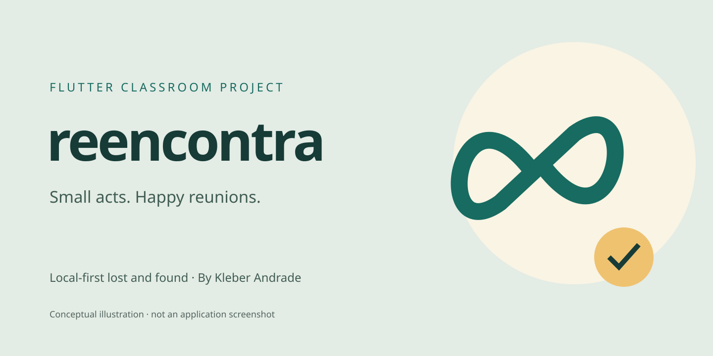
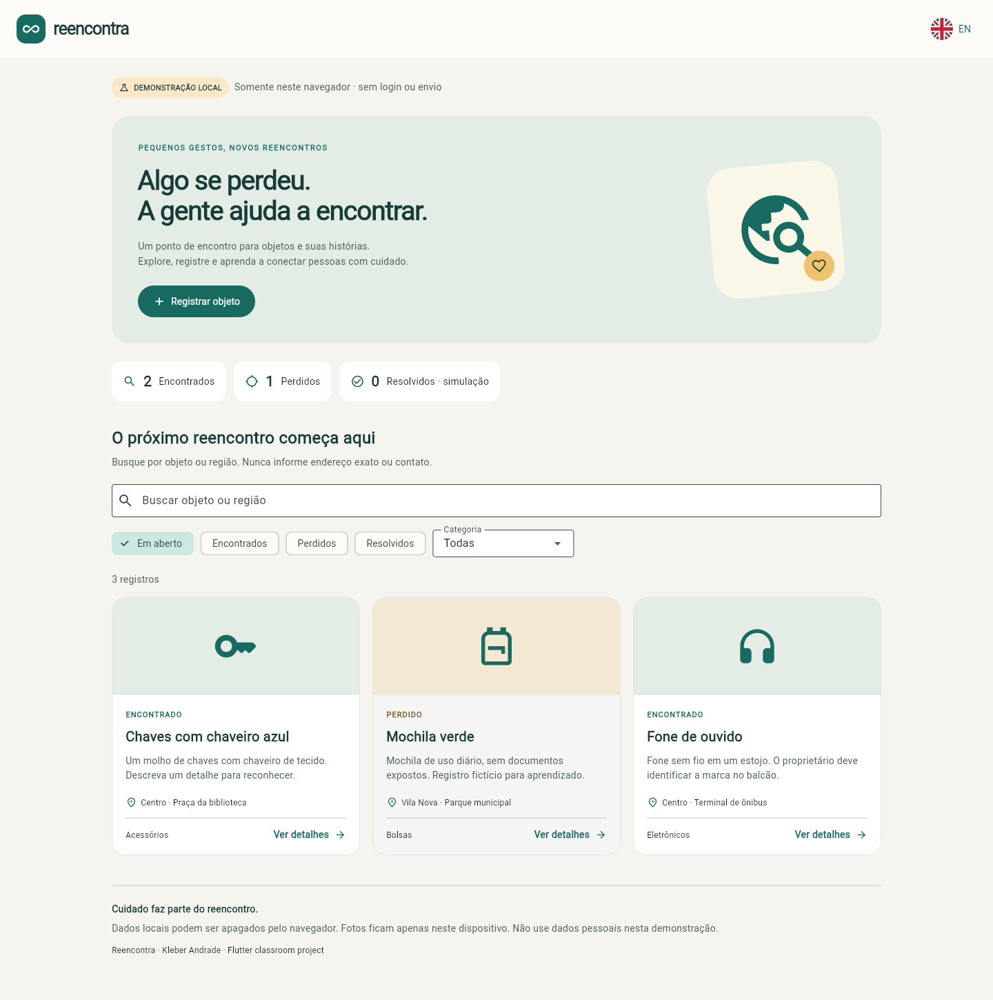
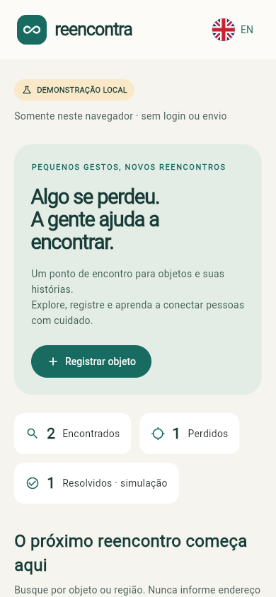
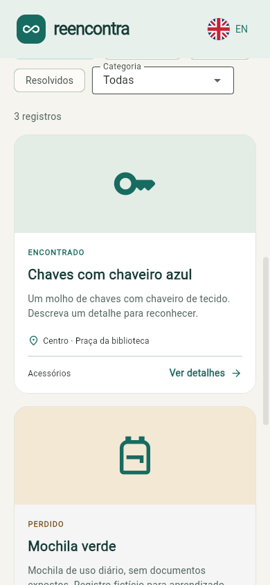

# Reencontra · Lost & Found



[](https://docs.flutter.dev/)
[](pubspec.yaml)
[](LICENSE)

A classroom app by **Kleber Andrade**, modernized from the original Flutter project. Reencontra lets you explore the full lost-and-found workflow without credentials or a cloud account. **Everything runs as a clearly labeled local demonstration. It does not verify people, contact owners or confirm real returns.**

## Run it

Validated with **Flutter 3.41.9 stable / Dart 3.11.5**. Use this exact Flutter release (also recorded in `.fvmrc`), not the original Dart 2 environment.

```sh
flutter --version
flutter pub get --enforce-lockfile
flutter run -d chrome --web-port 8387
```

Keep the same browser profile and origin, including port, to retain the same local dataset. The first run is empty. Choose **Carregar 3 exemplos fictícios / Load 3 fictional examples** to explicitly add synthetic records, or create your own fictional listing.

```sh
flutter analyze
flutter test
flutter build web --no-web-resources-cdn
python3 -m http.server 8387 --directory build/web
```

Open `http://localhost:8387`. Run tests and builds sequentially on shared development machines. `build/web` is ready for a static host; this project has not deployed a website or backend. The optional `tool/flutterw` helper supports an isolated SDK/cache via `LOST_FOUND_FLUTTER` and `LOST_FOUND_PUB_CACHE`; ordinary installations should use `flutter` directly.

## What you can do

- Create **found** or **lost** listings with title, public description, category and approximate district/public place.
- Attach, replace or remove a local JPEG/PNG image, up to 350 KB after selection. Photos are saved in the local snapshot, with a 3 MB total snapshot limit.
- Search across title, description and area without case/accent differences. Combine category and open/found/lost/resolved filters.
- Edit open records. The original found/lost kind remains immutable.
- Explicitly confirm a **simulated resolution** with a note. Resolved listings move to their own filter and become read-only. The original kind is retained.
- Switch PT-BR/EN using locally drawn circular Brazil/UK flags. Labels change; user-entered content and records remain intact. The synthetic examples are Portuguese content.
- Recover from loading errors with retry. Save failures leave the displayed records unchanged and offer a retry of the pending snapshot.

## Current application captures



Desktop capture of the actual compiled Web application with explicitly loaded fictional examples.



Mobile browser viewport, not an Android/iOS device certification. The cover above is a separate conceptual SVG illustration.



## Architecture and examples

`lib/domain/listing.dart` owns validation, immutable records, search and the only allowed transition: `open → resolved`. `ListingKind` is found/lost; `ListingStatus` is open/resolved; `Category` is a fixed taxonomy (accessories, electronics, documents, bags, pets, other). `lib/domain/listing_repository.dart` defines the persistence boundary. `lib/data` contains local storage and opt-in fixtures. `lib/ui` contains responsive browsing, editing, language flags and the resolution dialog. No business rule relies on widget state alone.

This is the same public API exercised by the application and tests:

```dart
final item = Listing.create(
  id: 'example-keys',
  title: 'Chave azul',
  description: 'Registro fictício na biblioteca',
  area: 'Centro',
  category: Category.accessories,
  kind: ListingKind.found,
);
final matches = searchListings([item], query: 'CHAVE',
  category: Category.accessories, status: ListingStatus.open);
final resolved = matches.single.resolve(
  'Simulação conferida no balcão', confirmed: true);
await repository.save([resolved]);
```

Import the model from `package:lost_and_found/domain/listing.dart`; `repository` is an injected `ListingRepository`. Storage parses and validates incoming JSON before accepting it. A corrupt snapshot raises an error instead of being replaced with sample data. Writes update visible state only after persistence succeeds.

See [backend contract](docs/backend-contract.md), [validation record](docs/validation.md), [lesson revision](docs/lesson-pt-BR.md), [changelog](CHANGELOG.md) and [contributing guide](CONTRIBUTING.md).

## Dependencies and toolchain limits

Direct packages are `shared_preferences 2.5.6`, `image_picker 1.2.4`, and `flutter_lints 6.0.0`; exact transitive versions are committed in `pubspec.lock`. They are the stable compatible direct versions verified during this revision. Flutter 3.41.9 is the locally available stable toolchain selected and isolated for this project, **not a claim to the newest Flutter release**. `flutter pub upgrade` found no compatible upgrades on that pin. Newer transitive releases require incompatible SDK/package constraints; there are no forced overrides. Re-evaluate the pin and run all checks together when upgrading.

Unused legacy Firebase, Firestore and Google Sign-In packages were removed rather than configured as fictitious services. A future authenticated backend must implement the [documented boundary and privacy rules](docs/backend-contract.md). The included Firestore rules deny all access and are emulator preparation only.

## Verified limits

- Browser local storage is a small, single-writer demo store, not a secure or backed-up database. Clearing site data, private mode, storage quotas or a different origin can remove/hide records. Concurrent tabs can overwrite one another; use one active writing tab.
- There is no authentication, moderation, cloud sync, live map, GPS collection, private messaging or real return verification. Approximate location is intentionally free text naming a district/public space.
- Text validation rejects common contact/link/coordinate patterns; it cannot recognize all personal data or residential addresses. Use fictional data and do not enter identifying details.
- Photos never upload anywhere. The picker requests no full metadata, but metadata removal is not guaranteed by every platform. Do not use sensitive photos; a production photo service must decode/re-encode and strip EXIF/GPS.
- Web Chrome desktop and mobile-sized viewport are validated. Android/iOS scaffolds were regenerated for the pinned SDK, with an iOS photo-library description; native builds, permissions, camera and real devices were not tested. Gallery selection is the only image source used.
- The Web build bundles rendering resources; the first load still needs an HTTP server. No offline/PWA installation or browser accessibility certification is claimed. Keyboard access, control labels and semantic content are supplied; screen-reader behavior needs platform testing.

## Teaching material and credits

The original source contained an empty login screen, not a complete Firebase app. The teaching revision follows the actual new implementation rather than preserving obsolete setup examples. No Medium URL or editorial session was available, so a complete Portuguese lesson is prepared in [docs/lesson-pt-BR.md](docs/lesson-pt-BR.md). No article was published and no newsletter was sent.

Original project and modernization: Kleber Andrade. Git history and original author credits are preserved. User-owned project code is licensed under [MIT](LICENSE); Flutter, Dart and package authors retain their own respective licenses. UI illustrations and flags are locally drawn; application captures show synthetic data.
