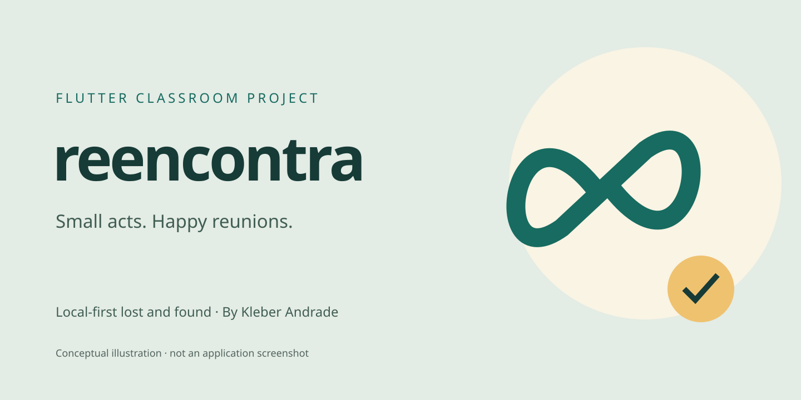
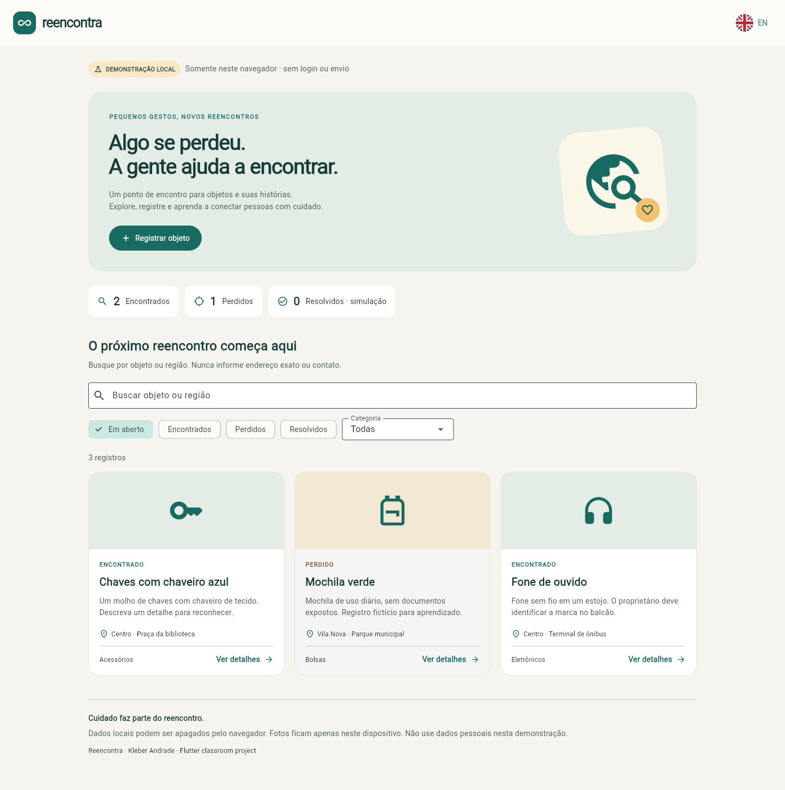
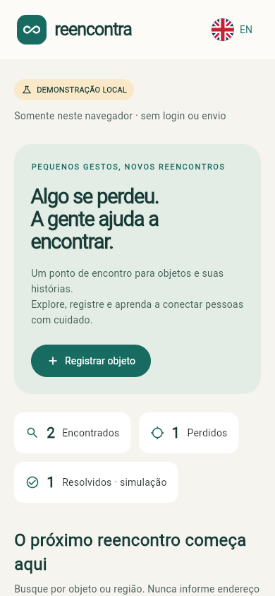

# Reencontra: achados e perdidos com Flutter e persistência local

Por **Kleber Andrade**. Revisão editorial preparada para o projeto `lost-and-found-flutter`.

> Estado editorial: não foi encontrada uma URL de aula no repositório, nem uma sessão conectada de edição do Medium. Este documento é uma revisão concreta para publicação posterior na aula própria correspondente, preservando idioma, autoria e URL original quando ela for identificada. Nenhum artigo, newsletter ou e-mail foi enviado.



Perder um objeto pode ser um pequeno transtorno ou interromper a rotina de alguém. Um aplicativo de achados e perdidos é um bom exercício para aprender mais do que desenhar uma lista: precisamos representar estados, validar entradas, pesquisar, guardar dados e comunicar os limites do serviço.

Nesta versão construiremos uma **demonstração local**, sem autenticação nem acesso a dados reais. O projeto anterior continha apenas uma tela de login vazia e dependências antigas do Firebase. Não seria correto apresentar essa tela como um serviço funcional. Nosso objetivo agora é permitir cadastrar, editar, encontrar e resolver registros fictícios do início ao fim.

## 1. Execute uma base reproduzível

Use Flutter **3.41.9 stable**, com Dart **3.11.5**. Essa é a versão efetivamente validada, não uma afirmação de que seja a mais recente disponível. O intervalo Dart do manifesto é `>=3.11.0 <4.0.0`. As dependências diretas usadas são `shared_preferences 2.5.6`, `image_picker 1.2.4` e `flutter_lints 6.0.0`. O arquivo `pubspec.lock` fixa as transitivas compatíveis; não usamos overrides para forçar incompatibilidades.

```sh
flutter --version
flutter pub get --enforce-lockfile
flutter run -d chrome --web-port 8387
```

A tela começa vazia. Clique em **Carregar 3 exemplos fictícios** para explorar registros sintéticos. Os exemplos não representam pessoas, objetos ou devoluções reais. Use sempre o mesmo navegador e a mesma origem, inclusive a porta, para observar os dados salvos anteriormente.



A captura mostra a aplicação compilada, não um protótipo visual. A ilustração da capa é conceitual.

## 2. Modele o objeto antes da tela

Abra `lib/domain/listing.dart`. Temos três conceitos diferentes: `ListingKind` distingue encontrado e perdido; `ListingStatus` distingue aberto e resolvido; `Category` oferece uma taxonomia fixa. Manter esses conceitos separados preserva a informação de origem depois da resolução.

```dart
final item = Listing.create(
  id: 'example-keys',
  title: 'Chave azul',
  description: 'Registro fictício na biblioteca',
  area: 'Centro',
  category: Category.accessories,
  kind: ListingKind.found,
);
```

Esse trecho usa a API real da aplicação. Importe `package:lost_and_found/domain/listing.dart`. O construtor valida o título entre 3 e 70 caracteres, a descrição entre 3 e 400 e a região entre 3 e 60. Campos são imutáveis: editar produz um novo objeto. O tipo encontrado/perdido e a data de criação permanecem os mesmos.

Os padrões de validação bloqueiam contatos, links e coordenadas comuns. Isso ajuda a ensinar o limite público, mas não é uma ferramenta capaz de reconhecer todos os dados pessoais. Nunca digite nome completo, endereço residencial, documentos ou detalhes secretos que deveriam ser usados para conferir a posse.

## 3. Separe persistência e apresentação

`ListingRepository` declara `load()` e `save(listings)`. A implementação local recebe `SharedPreferences`; as telas dependem do contrato, não de Firebase. Esse isolamento permite testar o comportamento com memória e implementar uma integração futura sem esconder um serviço fictício atrás de um botão de login.

```dart
final repository = LocalListingRepository(
  await SharedPreferences.getInstance(),
);
await repository.save([item]);
final restored = await repository.load();
```

Além do modelo, importe `package:shared_preferences/shared_preferences.dart` e `package:lost_and_found/data/local_repository.dart`. Em uma aplicação Flutter, inicialize o binding antes de usar plugins fora de widgets. No aplicativo deste projeto, o carregamento ocorre depois de `runApp`.

O snapshot fica na chave `reencontra.v1`. No Web, o plugin usa o armazenamento local do navegador. Ao carregar, o JSON passa novamente pela validação de domínio. Um arquivo corrompido resulta em erro visível com nova tentativa; o aplicativo não apaga o conteúdo para colocar exemplos no lugar. A tela só aceita o novo estado depois de uma gravação bem-sucedida. Em caso de falha, oferece nova tentativa com o snapshot pendente.

O limite total é de 3 MB. Esta é uma implementação para um único escritor local: duas abas editando simultaneamente podem sobrescrever dados. Armazenamento do navegador não é backup, autenticação nem cofre seguro.

## 4. Busque combinando critérios

A busca normaliza caixa e acentos de título, descrição e região. Os filtros são combinados com essa busca, não aplicados de maneira independente.

```dart
final matches = searchListings(
  [item],
  query: 'CHAVE',
  category: Category.accessories,
  status: ListingStatus.open,
);
```

A função retorna uma nova lista, ordenada pela criação mais recente. A aba de resolvidos solicita `ListingStatus.resolved`; as outras exibem registros abertos. Por isso uma resolução deixa de aparecer em "Em aberto", mas continua acessível em "Resolvidos".

Uma busca sem resultados tem explicação e orientação para tentar outro termo. O estado inicial vazio também oferece o carregamento explícito de exemplos. Não confunda ausência de registros com falha de armazenamento.

## 5. Trate fotos e localização com cuidado

O formulário seleciona uma imagem da galeria usando `ImagePicker().pickImage`, limita dimensões solicitadas a 1000 × 1000 e qualidade a 75, e pede `requestFullMetadata: false`. O conteúdo aceito deve ter assinatura PNG/JPEG e até 350 KB depois da seleção. A foto é codificada em base64 dentro do snapshot local. Ela pode ser substituída ou removida durante uma edição aberta.

A validação local de assinatura não é um pipeline completo de saneamento de imagens. O seletor não garante remoção de todos os metadados em todas as plataformas. Uma integração pública precisaria decodificar, recodificar, remover EXIF/GPS e moderar imagens no servidor. Aqui nada é enviado: escolha somente imagens sintéticas, sem pessoas ou informações sensíveis.

A localização é apenas o nome de um bairro ou espaço público. Não há GPS, mapa preciso ou coleta de coordenadas. Essa escolha reduz exposição e mantém o exemplo executável sem chaves de serviço.



Esta é uma captura de viewport Web de 390 pixels; não comprova teste em aparelho Android ou iOS.

## 6. Resolva com uma transição explícita

```dart
final resolved = item.resolve(
  'Simulação conferida no balcão',
  confirmed: true,
);
await repository.save([resolved]);
```

A nota precisa ter entre 3 e 160 caracteres. Sem confirmação, a operação é rejeitada. A transição é apenas `open → resolved`: um registro resolvido não pode ser resolvido de novo nem editado. O identificador, tipo original e conteúdo são preservados. A tela pede a confirmação de que se trata de uma simulação e apresenta a nota depois da conclusão.

Isso não prova que alguém devolveu um objeto. Em produção, seria necessário desenhar verificação presencial, consentimento e controles de acesso. O contrato em `docs/backend-contract.md` explica comandos autenticados, revisões para concorrência e saneamento de imagens. As regras Firestore incluídas negam todo acesso. Não existe adaptador remoto conectado e o emulador não foi executado neste ambiente.

## 7. Valide comportamento e limites

```sh
flutter analyze
flutter test
flutter build web --no-web-resources-cdn
```

Execute testes e build sequencialmente. A suíte cobre normalização, filtros, validação de dados sensíveis, confirmação, persistência depois de editar e resolver, armazenamento corrompido, cadastro em largura móvel, troca de idioma, recuperação de carregamento e bloqueio de edição após resolução. A execução Web real também verifica recarga com dados persistidos.

As interfaces estão em português e inglês; as bandeiras circulares são desenhadas localmente e têm rótulo e tooltip. Trocar o idioma preserva o conteúdo digitado e os registros. Texto fornecido pelo usuário não é traduzido automaticamente.

Android e iOS têm estruturas regeneradas pelo SDK, mas não foram compilados nem testados em dispositivos. Não apresentamos câmera, permissões móveis, acessibilidade por leitor de tela ou backend como verificados. Essas limitações fazem parte do aprendizado: documentar precisamente o que funciona é melhor do que ampliar promessas sem testes.

## Referências e créditos

- Projeto e autoria: [Kleber Andrade — lost-and-found-flutter](https://github.com/kleberandrade/lost-and-found-flutter).
- [Documentação Flutter](https://docs.flutter.dev/) e [arquivo do SDK](https://docs.flutter.dev/install/archive).
- [shared_preferences](https://pub.dev/packages/shared_preferences) e [image_picker](https://pub.dev/packages/image_picker).
- [Testes Flutter](https://docs.flutter.dev/testing/overview).
- Código próprio sob MIT; dependências preservam suas licenças. Capa e bandeiras desenhadas localmente; capturas da aplicação real usam registros fictícios.

## Exercícios práticos

1. **Combine busca e filtros.** Cadastre cinco objetos fictícios de duas categorias e dos dois tipos. Critério de conclusão: demonstre uma busca com acentos equivalentes, um filtro por categoria e um resultado vazio, sem alterar os registros.
2. **Comprove a persistência.** Cadastre um objeto, edite sua região e recarregue a mesma origem. Critério de conclusão: título e região reaparecem corretamente e um teste automatizado verifica o ciclo salvar/carregar.
3. **Valide a resolução.** Tente concluir sem confirmação e com nota vazia; depois conclua com dados válidos. Critério de conclusão: as tentativas inválidas são bloqueadas, o registro muda de aba e não oferece mais edição.
4. **Teste os limites de fotos.** Escolha um PNG/JPEG pequeno, substitua-o e remova-o; tente um arquivo incompatível ou acima do limite. Critério de conclusão: o fluxo válido persiste e a falha mostra mensagem sem modificar o registro salvo.
5. **Projete o adaptador remoto.** A partir do contrato de backend, escreva testes com dados sintéticos para acesso sem autenticação, edição de outro proprietário e revisão desatualizada. Critério de conclusão: todos rejeitam a operação em um ambiente isolado, sem conectar a produção nem apresentar simulações como devoluções reais.
